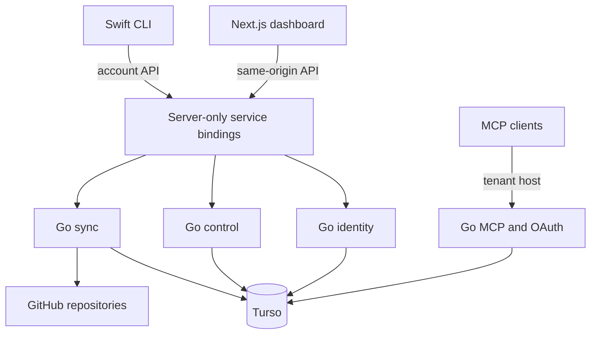

# Architecture Overview

MyContextProtocol runs as one Vercel project with a Next.js dashboard and four Go HTTP services. `main` deploys to Production; feature branches deploy to isolated Previews. The Swift CLI remains a supported native client.

- `apps/web` serves the Next.js dashboard and same-origin API forwarding through server-only service bindings.
- `services/go/cmd/identity` handles GitHub login, sessions and App installation callbacks.
- `services/go/cmd/control` handles account/project/admin APIs and bounded maintenance.
- `services/go/cmd/mcp` serves tenant-bound MCP and OAuth/PKCE.
- `services/go/cmd/sync` handles signed webhooks and bounded repository compilation.
- `services/go/cmd/migrate` and `cmd/import` provide explicit schema and verified snapshot operations.
- `apps/context` contains the Swift MyContextCLI (`myctx`).
- `packages/mycontext-web-client` contains shared TypeScript contracts; `packages/mycontext-api-contract` documents the management API.

Services use stateless Turso HTTP queries with durable jobs, leases and catalog revisions. Database changes are explicit operator actions, never service-startup migrations. Browser session validation, ownership checks, CSRF protection and tenant binding remain enforced. All accounts have full feature access without payment gates.

The retired Swift/Vapor backend and Railway deployment tooling are available in Git history. Current recovery uses the Go snapshot tooling and requires verified current data before any traffic change.
